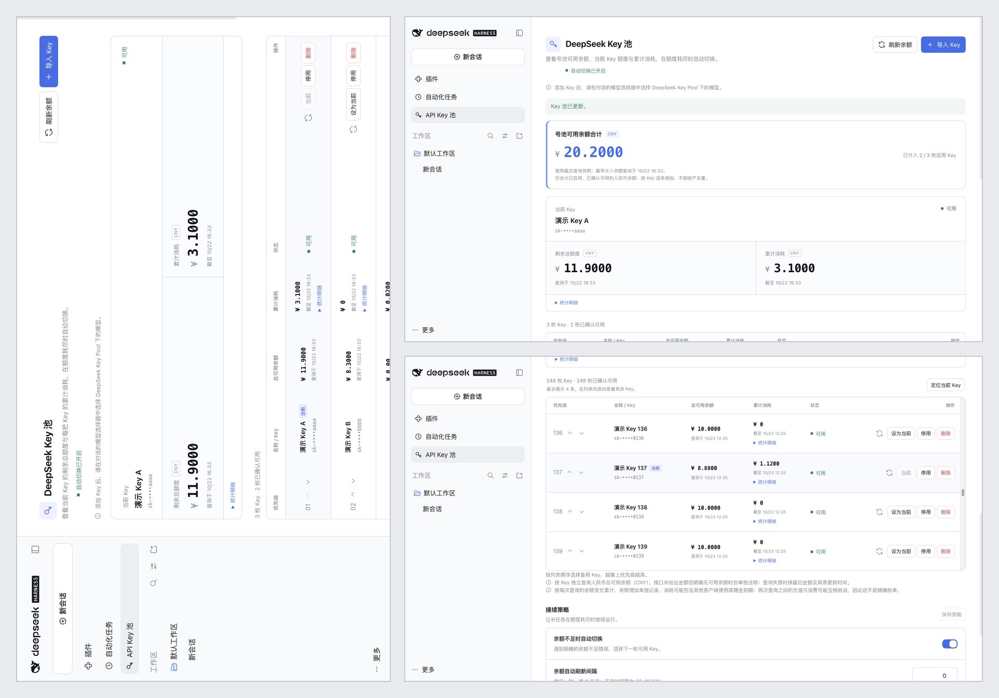

<h1 align="center">DeepSeek Harness API Key Pool</h1>

<p align="center">
  <strong>Multi-key pool management for DeepSeek Harness: priority scheduling · automatic failover on insufficient balance</strong><br/>
  Built for the official <a href="https://github.com/deepseek-ai/deepseek-harness">DeepSeek Harness</a>. Official API only — no third-party relays.
</p>

<p align="center">
  <a href="https://github.com/Xpropel/dsh-keys-manager/releases"></a>
  
  
  
  <a href="LICENSE"></a>
</p>

<p align="center">
  <a href="#features">Features</a> · <a href="#screenshots">Screenshots</a> · <a href="#installation">Installation</a> · <a href="#usage">Usage</a> · <a href="README.md">中文</a>
</p>

## Screenshots

<p align="center">
  
</p>

## Features

- **Bulk import**: 1–200 keys per batch, optional `Label | Key` naming; only printable ASCII keys without whitespace are accepted, and the result reports how many were added versus skipped as duplicates; the list only ever shows masked keys
- **Balance checks**: per-key balances via the official balance endpoint, whose address follows the official provider's configured `baseURL` (default `api.deepseek.com`) — USD and other currencies included, converted to CNY at live exchange rates — computed with exact BigInt decimal arithmetic; pool-wide available total and cumulative consumption at the top of the page
- **Priority management**: search, pagination (20/50/100 per page), move-to-top, set current key, move up/down, enable/disable, delete (which also removes that key's dedicated credential) — usable even with 249 keys
- **Automatic failover**: only an explicit HTTP `402` (insufficient balance) from a model request triggers a switch to the next available key by priority; all other errors are passed back to the official handling untouched. One request tries at most 5 keys, so a pool-wide 402 storm cannot loop forever
- **State protection**: a balance refresh round persists once at the end; on startup a `state.json.bak` snapshot is written so corrupt metadata can be restored from it
- **Official alignment**: normal requests reuse the official provider's live configuration, model catalog and transport — no second set of parameters to drift
- **Diagnostics**: failed requests are logged with category, error code and timing only — never full keys, prompts or payloads

## Installation

1. Use the `dsh-deepseek-key-pool-<version>.tgz` archive for the version you want to install. Published packages are available on [Releases](https://github.com/Xpropel/dsh-keys-manager/releases).
2. In the DeepSeek Harness desktop app, open **Plugins → Add plugin → Install third-party plugin**, enter the absolute path of the package, install and enable it.
3. Open **API Key Pool** in the sidebar.

The package ships prebuilt; no compilation is needed.

## Usage

1. **Import keys**: click **Import Key** on the pool page, one key per line, optionally named as `Label | Key`:

   ```text
   <your API key>
   Work | <your API key>
   ```

2. **Select the model**: in a session's model picker, choose a model under `DeepSeek Key Pool`. Sessions using the regular DeepSeek provider do not go through the pool, and the plugin never rewrites existing sessions in bulk.
3. **Manage and configure**: reorder the current and backup keys in the list; under **Failover policy** you can toggle automatic switching and set the balance refresh interval (default 300 seconds, `0` disables scheduled refresh).

## Switching rules

| Situation | Behavior |
| --- | --- |
| Model request returns HTTP `402` | Marks the key as exhausted; with auto-switch on, continues with the next key by priority |
| `401` / `403`, rate limits, server or network errors | No switch; official errors and official retry behavior are preserved |
| No candidate key available | Stops the current round and reports the pool status |
| One request has tried 5 keys and still gets `402` | Stops the round and preserves the official 402 error; the diagnostic log records `KEY_POOL_ROTATION_LIMIT` |
| Auto-switch off | Uses only the manually selected current key; stops with a notice if it is unavailable |

Consumption is tracked per key from balance snapshots: a decrease counts as consumption, an increase as top-up. It is an estimate derived from snapshots, not an official bill. Keys belonging to the same account share one account balance; the plugin displays and sums per key and does not deduplicate by account.

## Data storage

- Metadata lives in `~/.dsh/plugins/deepseek-key-pool/state.json` (under your custom `DSH_HOME` if set) and stores only labels, order, masked keys, balance caches and statistics — **never full API keys**.
- Full keys are managed by the Harness credentials service; its default local implementation is a private credential file, not an encrypted vault or OS keychain.
- After a successful startup load the plugin writes a `state.json.bak` snapshot beside it. If `state.json` is corrupt, the plugin reports both paths so the backup can be copied back over `state.json` and the app restarted (full keys always stay in the official credentials service and are unaffected).
- The diagnostic log is `request-errors.json` in the same directory, capped at the most recent 100 entries.
- Uninstalling the plugin does not delete this data; delete keys inside the plugin so their credentials are cleaned up too.

## What's new

### 0.7.0

- Fixed DSH 0.2.2 / Cordis 4.1 compatibility: 402 retries dispatch a new request, so raw non-agent streams no longer fail on the single-call `next()` restriction; retries reuse the official connection of the failed attempt
- One request tries at most 5 keys; hitting the cap is recorded in the diagnostic log
- Balance checks follow the official provider's `baseURL` instead of a hard-coded endpoint
- A balance refresh round persists once, cutting disk writes and lock contention
- Import validates key character sets, reports added/duplicate counts, and pre-checks the 1–200 batch limit
- Corrupt `state.json` guidance plus a `state.json.bak` snapshot; a disabled official provider falls back to validated schema defaults
- Long lists support search, pagination and move-to-top; the delete confirmation manages focus and supports Escape; statistics scope notes are shown in the UI
- UI theme tokens converge on official public tokens, fixing light/dark and font-setting consistency
- Removed the settings-page shortcut that could not close the settings layer; the sidebar entry remains

## Development

Requires Node.js 22.19 or newer:

```sh
npm ci
npm run check   # typecheck + automated tests + build
npm pack        # produce the installable .tgz package
```

Main code: `src/pool.ts` (key selection, state, refresh), `src/provider.ts` and `src/official-*.ts` (official-call alignment and 402 failover), `src/bridge.ts` (management RPC), `src/client/` (management UI); tests live in `tests/`.

## License

[MIT](LICENSE)
