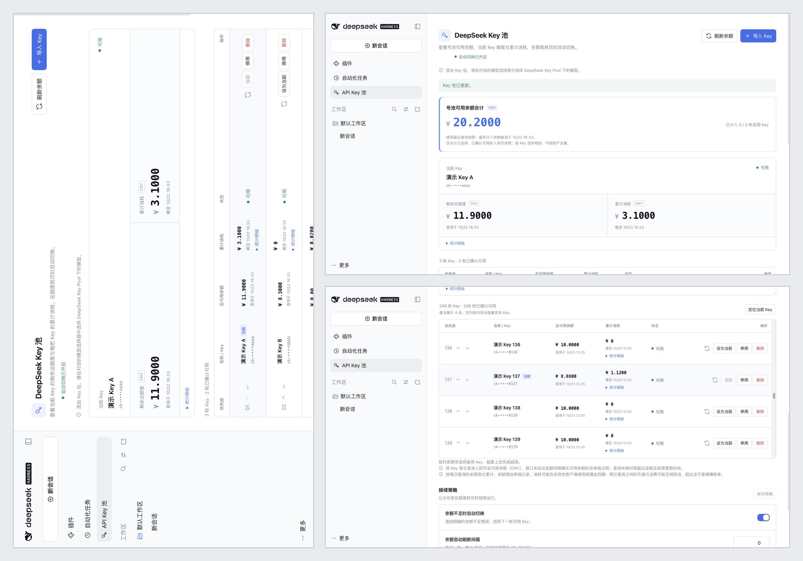

<h1 align="center">DeepSeek Harness API Key 池</h1>

<p align="center">
  <strong>多 API Key 号池管理插件：优先级调度 · 额度不足自动切换</strong><br/>
  为官方 <a href="https://github.com/deepseek-ai/deepseek-harness">DeepSeek Harness</a> 而建，使用官方 API，不接入第三方中转平台。
</p>

<p align="center">
  <a href="https://github.com/Xpropel/dsh-keys-manager/releases/tag/v0.6.3"></a>
  
  
  
  <a href="LICENSE"></a>
</p>

<p align="center">
  <a href="#功能">功能</a> · <a href="#界面预览">界面预览</a> · <a href="#安装">安装</a> · <a href="#使用">使用</a> · <a href="README.en.md">English</a>
</p>

## 界面预览

<p align="center">
  
</p>

## 功能

- **批量导入**：每批 1–200 枚 Key，支持 `名称 | Key` 命名；重复自动跳过，列表只显示脱敏 Key
- **余额查询**：通过官方余额接口读取每枚 Key 的余额，支持 USD 等多币种并按汇率统一换算为人民币，金额用 BigInt 十进制精确计算；页面顶部汇总号池可用余额与累计消耗
- **优先级管理**：设为当前、上移 / 下移、停用 / 启用、删除（同时清理该 Key 的专属凭据）
- **自动切换**：模型请求明确返回 HTTP `402`（额度不足）时，按优先级换用下一枚可用 Key；其余错误原样交回官方处理
- **官方对齐**：正常请求复用官方提供方的实时配置、模型目录与传输实现，不维护第二套参数
- **诊断日志**：请求失败只记录分类、错误码与耗时等脱敏信息，不保存完整 Key、提示词或正文

## 安装

1. 从 [Releases](https://github.com/Xpropel/dsh-keys-manager/releases) 下载 `dsh-deepseek-key-pool-0.6.3.tgz`。
2. 在 DeepSeek Harness 桌面端打开 **插件 → 添加插件 → 安装第三方插件**，填写安装包的绝对路径，完成安装并启用插件。
3. 在左侧栏打开 **API Key 池**。

安装包已包含构建结果，无需自行编译。

## 使用

1. **导入 Key**：在 API Key 池页面点击 **导入 Key**，每行一枚，可用 `名称 | Key` 命名：

   ```text
   <你的 API Key>
   工作 | <你的 API Key>
   ```

2. **选择模型**：在会话的模型选择器中选择 `DeepSeek Key Pool` 下的模型。使用普通 DeepSeek 提供方的会话不会经过号池，插件不会批量改动已有会话。
3. **管理与策略**：在列表中调整当前 Key 与备用顺序；在 **接续策略** 中可开关自动切换、设置余额刷新间隔（默认 300 秒，填 `0` 关闭定时刷新）。

## 切换规则

| 情况 | 行为 |
| --- | --- |
| 模型请求返回 HTTP `402` | 标记该 Key 额度不足；自动切换开启时按优先级接续下一枚 |
| `401` / `403`、限流、服务端或网络错误 | 不换 Key，保留官方错误与官方重试行为 |
| 全部候选 Key 不可用 | 停止本轮并提示池状态 |
| 自动切换已关闭 | 只用手动选定的当前 Key，不可用时停止并提示 |

余额统计按每枚 Key 独立记录：余额下降计入累计消耗，上升计入累计增加。这是按余额快照推算的统计，不是官方精确账单。同一账户下的多枚 Key 共享同一份账户余额，插件按 Key 展示与相加，不做账户去重。

## 数据存放

- 元数据存放在 `~/.dsh/plugins/deepseek-key-pool/state.json`（自定义 `DSH_HOME` 时在对应目录下），只保存名称、顺序、脱敏 Key、余额缓存与统计，**不保存完整 API Key**。
- 完整 Key 交给 Harness 官方 credentials 服务管理；其默认本地实现是私有凭据文件，不是加密保险库或系统钥匙串。
- 诊断日志位于同目录的 `request-errors.json`，仅保留最近 100 条。
- 卸载插件不会自动删除数据；删除 Key 请在插件内逐条删除，以便同步清理凭据。

## 开发

需要 Node.js 22.19 或更新版本：

```sh
npm ci
npm run check   # 类型检查 + 自动化测试 + 构建
npm pack        # 生成可安装的 .tgz 包
```

主要代码：`src/pool.ts`（Key 选择、状态与刷新）、`src/provider.ts` 与 `src/official-*.ts`（官方调用对齐与 402 接续）、`src/bridge.ts`（管理 RPC）、`src/client/`（管理页面），测试在 `tests/`。

## 许可证

[MIT](LICENSE)
